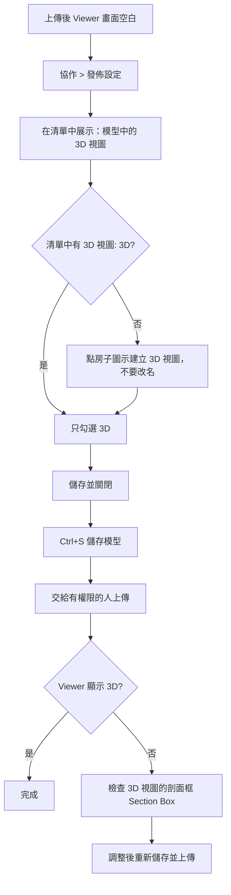

# Revit 發佈設定：3D 視圖上傳 Viewer 後畫面空白的處理

## 1. 問題

Revit 中看得到 3D 模型，但上傳到 Viewer 後畫面空白、無法顯示。

資料來源：使用者提供的搜尋結果截圖與 Revit 2025.5「發佈設定」視窗截圖。截圖中引用的 Autodesk 官方網站與 YouTube 影片未實際開啟，內容【無法驗證】。

---

## 2. 搜尋結果建議的三個檢查項目

| 順序 | 檢查項目 | 做法 |
|---|---|---|
| 1 | 發佈設定是否納入 3D 視圖 | 「協作」頁籤 > 「發佈設定」> 勾選 {3D} > 儲存並關閉 > 重新儲存模型 |
| 2 | 專案中是否有預設 {3D} 視圖 | 快速存取工具列點「房子」圖示；專案瀏覽器中確認有 {3D}（保留大括號），不要改名 |
| 3 | 剖面框（Section Box）是否把模型切掉 | 開啟 3D 視圖，在「性質」面板檢查「剖面框」，確認未切掉模型，或取消勾選後重新儲存 |

---

## 3. 發佈設定的操作步驟（依實際截圖）

1. 開啟「協作」頁籤 > 「發佈設定」。
2. 「在清單中展示」下拉選單選擇 **「模型中的 3D 視圖」**。
3. 清單顯示 5 個 3D 視圖：
   - {3D - 64118}
   - {3D - 64240}
   - {3D - cyy63487}
   - {3D - grimedt}
   - {3D}
4. 只勾選 **{3D}**（截圖中其餘四個為未勾選）。
5. 點擊「儲存並關閉」。
6. 在 Revit 儲存模型檔案（Ctrl + S）。

### 補充

- 除 {3D} 外，其他四個視圖的名稱看不出用途，用途【無法驗證】。若要確認，可在專案瀏覽器展開「三維視圖」逐一開啟檢視。
- 不要刪除或改名這些視圖。

---

## 4. 彈出視窗「未選取任何集」

視窗文字：「您尚未選取要發佈的集。只有預設的 3D 視圖和 2D 圖紙會發佈到雲端。」

| 按鈕 | 結果 |
|---|---|
| 確定 | 接受預設，發佈預設 {3D} 與 2D 圖紙 |
| 取消 | 回到發佈設定視窗，自行調整 |

此說明只依據視窗文字，未實際測試發佈結果。

---

## 5. 沒有上傳權限時

- 請 Autodesk 專案管理者或 IT 確認帳號是否可上傳或編輯該專案。權限範圍（專案資料夾、特定檔案或 Viewer 功能）需看完整錯誤訊息才能判斷。
- 先在本機完成第 3 節設定並儲存模型檔，再交給有權限的人上傳。
- 發佈設定是否隨模型檔保存、上傳者是否沿用，【無法驗證】。請上傳者上傳後直接確認 Viewer 是否顯示 3D。

---

## 6. 整體流程

---

## 7. 尚未確認事項

| 項目 | 狀態 |
|---|---|
| 發佈設定是否被保存於模型檔並隨檔案交給他人 | 【無法驗證】 |
| 上傳權限不足的具體原因 | 【無法驗證】，需完整錯誤訊息 |
| 其他四個 3D 視圖的用途 | 【無法驗證】 |
| 上傳後 Viewer 是否正常顯示 | 尚未實際測試 |
